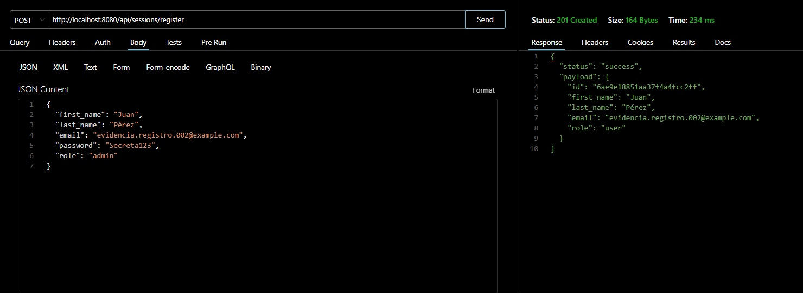
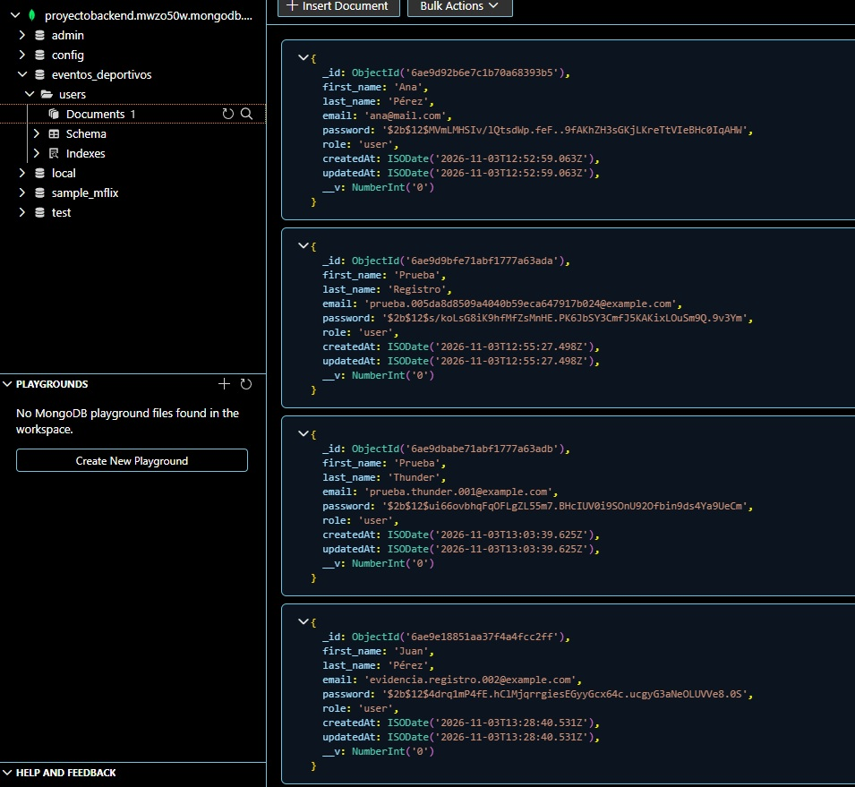
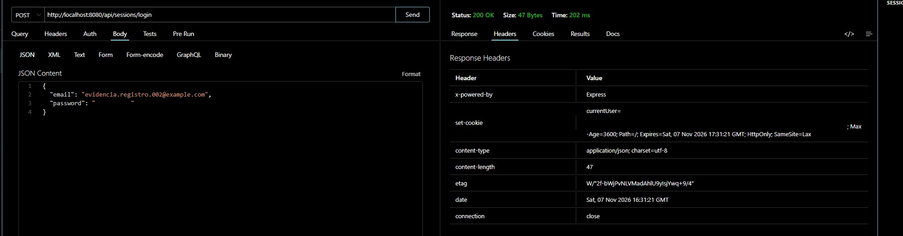
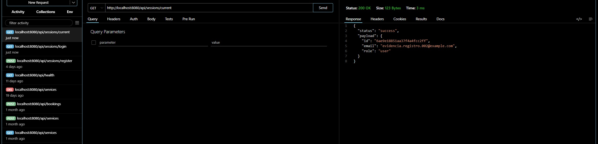
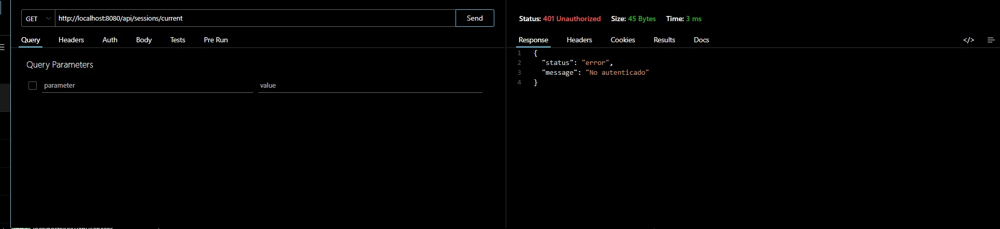
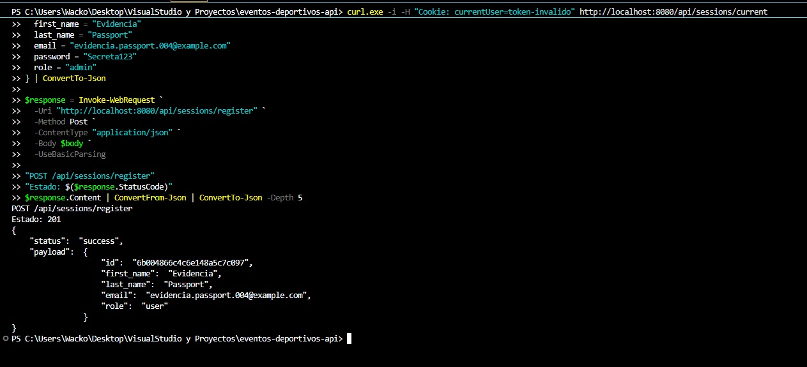
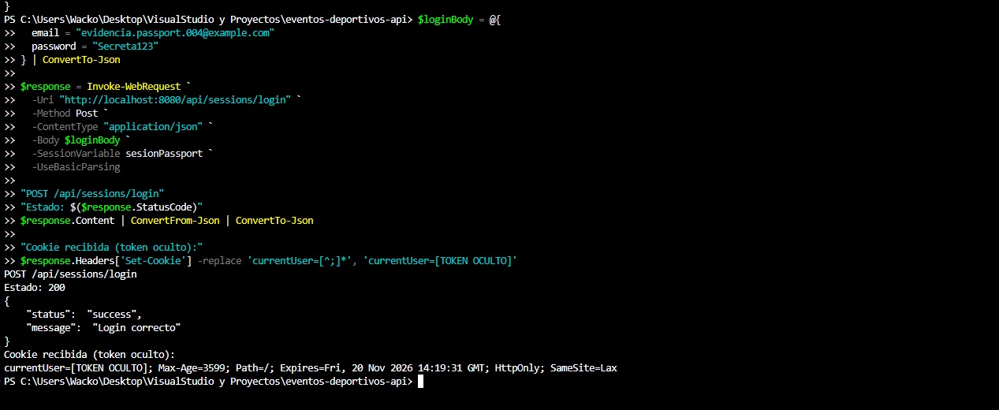
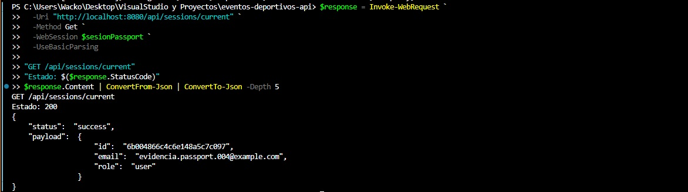
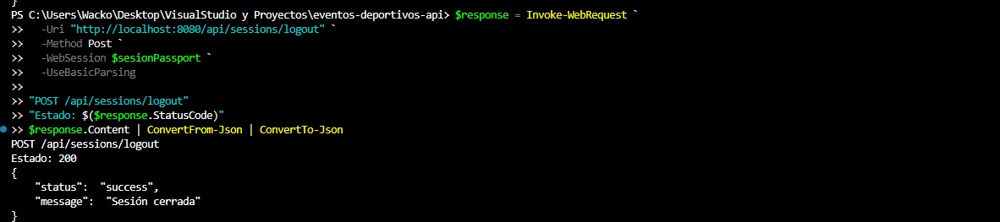
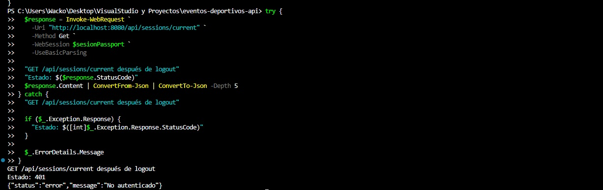

# Eventos Deportivos API

API REST para una plataforma de eventos deportivos e inscripciones. Proyecto del curso Desarrollo Avanzado de Backend II.

La plataforma está orientada a publicar torneos, encuentros y clínicas deportivas y gestionar sus inscripciones.

La preentrega 4 centraliza la autenticación con estrategias de Passport.js, manteniendo las rutas y respuestas de la entrega anterior.

## Funcionalidades

- Registro de usuarios con validaciones y persistencia en MongoDB.
- Normalización del email y control de duplicados.
- Contraseñas protegidas con bcrypt.
- Registro público con rol `user`, independientemente del rol enviado.
- Login con JWT almacenado en una cookie HTTP Only.
- Consulta protegida del usuario autenticado.
- Logout mediante eliminación de la cookie.
- Estrategias de Passport centralizadas.
- Validación de `JWT_SECRET` al iniciar la aplicación.
- Duración de la cookie sincronizada con el vencimiento del JWT.

## Tecnologías

- Node.js 22 o superior.
- Express.
- MongoDB y Mongoose.
- Passport, passport-custom y passport-jwt.
- bcrypt.
- jsonwebtoken.
- cookie-parser.
- dotenv.
- Módulos ESM con import/export.

## Instalación

```bash
git clone https://github.com/dabouzajm-lang/eventos-deportivos-api.git
cd eventos-deportivos-api
npm ci
```

## Variables de entorno

Crear `.env` en la raíz tomando como referencia `.env.example`.

En PowerShell:

```powershell
Copy-Item .env.example .env
```

En Git Bash, Linux o macOS:

```bash
cp .env.example .env
```

Configuración de ejemplo:

```dotenv
PORT=8080
NODE_ENV=development
MONGO_URL=mongodb://127.0.0.1:27017/eventos_deportivos
JWT_SECRET=reemplazar_por_un_secreto_propio
JWT_EXPIRES_IN=1h
```

| Variable | Descripción |
| --- | --- |
| `PORT` | Puerto HTTP. Por defecto, `8080`. Debe ser un entero entre 1 y 65535. |
| `NODE_ENV` | Entorno de ejecución. En `production`, la cookie utiliza `Secure` y requiere HTTPS. |
| `MONGO_URL` | Cadena de conexión a MongoDB local o Atlas. Obligatoria. |
| `JWT_SECRET` | Secreto privado de al menos 32 bytes. El valor de ejemplo debe reemplazarse. |
| `JWT_EXPIRES_IN` | Duración del JWT con unidad explícita, por ejemplo `1h` o `30m`. Por defecto, `1h`. |

Para generar un secreto aleatorio:

```bash
node -e "console.log(require('node:crypto').randomBytes(32).toString('hex'))"
```

Guardar el resultado únicamente en `JWT_SECRET` dentro del archivo `.env`.

El servidor valida la presencia y longitud mínima del secreto al iniciar. Una longitud suficiente debe acompañarse de un valor aleatorio y privado.

`.gitignore` excluye `.env`, `node_modules` y logs. `.env.example` contiene únicamente valores de ejemplo.

## MongoDB

Para usar Atlas, configurar `MONGO_URL` con la cadena del clúster, un usuario de base de datos válido y acceso de red autorizado para la IP desde la que se ejecuta la API.

La URL local del ejemplo requiere una instancia de MongoDB ejecutándose en el puerto `27017`.

La aplicación selecciona la base `eventos_deportivos` mediante `dbName` en `src/config/database.config.js`. Los usuarios se guardan en la colección `users`.

## Ejecución

Desarrollo con reinicio automático:

```bash
npm run dev
```

Ejecución sin reinicio automático:

```bash
npm start
```

La aplicación conecta con MongoDB antes de levantar el servidor HTTP.

Dirección predeterminada:

```text
http://localhost:8080
```

## Arquitectura

Las responsabilidades están distribuidas entre configuración, rutas, estrategias, controladores, servicios, repositorios, DAO y modelos.

| Ubicación | Responsabilidad |
| --- | --- |
| `src/app.js` | Configura Express, JSON, cookies, inicialización de Passport y routers. |
| `src/server.js` | Conecta MongoDB e inicia el servidor HTTP. |
| `src/config/` | Configuración de entorno, base de datos y estrategias de Passport. |
| `src/routes/` | Define endpoints y conecta los middlewares con los controladores. |
| `src/controllers/` | Construye respuestas HTTP. El controlador de login genera el JWT y establece la cookie. |
| `src/services/` | Implementa las validaciones y operaciones del registro y login invocadas por las estrategias. |
| `src/repositories/` | Expone las operaciones de acceso a usuarios. |
| `src/dao/` | Realiza las consultas mediante Mongoose. |
| `src/models/` | Define los modelos `User` y `Event`. |
| `src/middlewares/` | Ejecuta Passport y conserva el formato JSON de los errores. |
| `src/utils/` | Helpers reutilizables de bcrypt, JWT y errores de aplicación. |

Archivos principales de autenticación:

- `src/config/passport.config.js`
- `src/routes/sessions.router.js`
- `src/controllers/sessions.controller.js`
- `src/services/sessions.service.js`
- `src/repositories/users.repository.js`
- `src/dao/users.dao.js`
- `src/models/User.js`
- `src/middlewares/auth.middleware.js`
- `src/utils/hash.js`
- `src/utils/jwt.js`

## Estrategias de Passport

Las estrategias se registran en `src/config/passport.config.js`.

### register

Usa `passport-custom` y delega en `registerUser`.

El servicio valida los campos, normaliza el email, verifica duplicados, hashea la contraseña y persiste el usuario con rol `user`.

Passport entrega el usuario seguro mediante `req.user`. El controlador devuelve la respuesta `201`.

### login

Usa `passport-custom` y delega en `loginUser`.

Verifica email y contraseña mediante bcrypt. Los errores de credenciales utilizan siempre el mensaje genérico `Credenciales inválidas`.

Después de la autenticación, el controlador genera el JWT y establece la cookie `currentUser`.

### current

Usa `passport-jwt`.

Extrae el token de la cookie `currentUser` y valida su firma con `JWT_SECRET`, el algoritmo `HS256` y su vencimiento.

El usuario queda disponible en `req.user` con `id`, `email` y `role`.

Si falta un token válido, responde `401` con `No autenticado`.

### Configuración sin sesiones de servidor

Las autenticaciones usan `session: false`. Cada petición protegida se autentica mediante el JWT de la cookie.

El archivo de configuración está organizado en funciones por estrategia. Esto permite incorporar estrategias para proveedores externos como Google o GitHub sin modificar `app.js`. Esos proveedores todavía no están implementados y requerirán sus credenciales y rutas de autorización y callback.

## Modelo User

| Campo | Características |
| --- | --- |
| `first_name` | Texto obligatorio. Se eliminan espacios exteriores. |
| `last_name` | Texto obligatorio. Se eliminan espacios exteriores. |
| `email` | Obligatorio, normalizado a minúsculas e indexado como único. |
| `password` | Hash bcrypt. Se excluye de las consultas por defecto mediante `select: false`. |
| `role` | Valores posibles `user`, `organizer` y `admin`. El registro público asigna `user`. |

La contraseña requiere al menos ocho caracteres sin contar espacios exteriores y admite un máximo de 72 bytes en UTF-8.

El control de duplicados incluye una consulta previa y el tratamiento del error de índice único de MongoDB.

## JWT y cookie

El JWT contiene los datos `id`, `email` y `role`, además de las marcas temporales de emisión y vencimiento generadas por la librería.

La cookie `currentUser` utiliza:

- `httpOnly: true`.
- `sameSite: 'lax'`.
- `path: '/'`.
- `secure: true` únicamente en producción.
- `maxAge` calculado a partir del tiempo restante hasta el vencimiento del JWT, configurado mediante `JWT_EXPIRES_IN`.

La contraseña no se incluye en el JWT ni en las respuestas.

Logout elimina la cookie del cliente. Un token previamente copiado conserva su validez hasta el vencimiento, porque no se implementa una lista de revocación.

## Rutas disponibles

| Método | Ruta | Descripción |
| --- | --- | --- |
| GET | `/api/health` | Comprueba que el servidor está activo. |
| GET | `/api/events` | Devuelve la lista inicial de eventos. |
| GET | `/api/sessions` | Informa el estado del recurso de sesiones. |
| POST | `/api/sessions/register` | Registra un usuario mediante Passport. |
| POST | `/api/sessions/login` | Autentica al usuario y establece la cookie. |
| GET | `/api/sessions/current` | Devuelve los datos del usuario autenticado. |
| POST | `/api/sessions/logout` | Elimina la cookie de autenticación. |

### GET /api/health

Sin body.

Respuesta `200 OK`:

```json
{
  "status": "ok",
  "message": "Servidor activo"
}
```

### GET /api/events

Sin body.

Respuesta `200 OK`:

```json
{
  "status": "success",
  "payload": []
}
```

### GET /api/sessions

Sin body.

Respuesta `200 OK`:

```json
{
  "status": "success",
  "message": "Recurso sessions preparado. Registro disponible."
}
```

### POST /api/sessions/register

Enviar `Content-Type: application/json`.

```json
{
  "first_name": "Ana",
  "last_name": "Pérez",
  "email": "Ana@Example.com ",
  "password": "Secreta123"
}
```

Respuesta `201 Created`:

```json
{
  "status": "success",
  "payload": {
    "id": "ID_DEL_USUARIO",
    "first_name": "Ana",
    "last_name": "Pérez",
    "email": "ana@example.com",
    "role": "user"
  }
}
```

El rol enviado en el body se ignora.

Los campos faltantes o inválidos responden `400 Bad Request` con el mensaje correspondiente. Por ejemplo:

```json
{
  "status": "error",
  "message": "Faltan campos obligatorios"
}
```

Un email duplicado responde `409 Conflict`:

```json
{
  "status": "error",
  "message": "El email ya está registrado"
}
```

### POST /api/sessions/login

Enviar `Content-Type: application/json`.

```json
{
  "email": "ana@example.com",
  "password": "Secreta123"
}
```

Respuesta `200 OK`, junto con la cookie `currentUser`:

```json
{
  "status": "success",
  "message": "Login correcto"
}
```

Un email inexistente o una contraseña incorrecta responden `401 Unauthorized` con el mismo mensaje:

```json
{
  "status": "error",
  "message": "Credenciales inválidas"
}
```

### GET /api/sessions/current

Sin body. Enviar la cookie `currentUser` obtenida durante el login.

Respuesta `200 OK`:

```json
{
  "status": "success",
  "payload": {
    "id": "ID_DEL_USUARIO",
    "email": "ana@example.com",
    "role": "user"
  }
}
```

Sin cookie, o con un token inválido o expirado, responde `401 Unauthorized`:

```json
{
  "status": "error",
  "message": "No autenticado"
}
```

### POST /api/sessions/logout

Sin body. El cliente debe procesar la eliminación de la cookie.

Respuesta `200 OK`:

```json
{
  "status": "success",
  "message": "Sesión cerrada"
}
```

## Pruebas manuales

Mantener el servidor activo en una terminal y ejecutar las peticiones desde otra terminal, Thunder Client o Postman.

Usar el mismo host en todas las peticiones y conservar las cookies entre login, current y logout.

| Paso | Prueba | Resultado esperado |
| --- | --- | --- |
| 1 | Registro con un email nuevo | `201`, email normalizado y respuesta sin contraseña. |
| 2 | Enviar `role: "admin"` durante el registro | El usuario se crea con rol `user`. |
| 3 | Login con el usuario registrado | `200` y cookie `currentUser`. |
| 4 | Consultar `/current` con la cookie | `200` con `id`, `email` y `role`. |
| 5 | Ejecutar logout usando la misma sesión | `200` y eliminación de la cookie. |
| 6 | Consultar `/current` después de logout | `401` con `No autenticado`. |
| 7 | Registrar nuevamente el mismo email | `409` con `El email ya está registrado`. |
| 8 | Login con contraseña incorrecta | `401` con `Credenciales inválidas`. |
| 9 | Login con email inexistente | `401` con `Credenciales inválidas`. |
| 10 | Consultar `/current` sin cookie | `401` con `No autenticado`. |
| 11 | Consultar `/current` con token inválido o expirado | `401` con `No autenticado`. |

Comprobaciones desde PowerShell sin cookie:

```powershell
curl.exe -i http://localhost:8080/api/sessions/current
```

Con una cookie mal formada:

```powershell
curl.exe -i -H "Cookie: currentUser=token-invalido" http://localhost:8080/api/sessions/current
```

Ambas peticiones deben responder `401`.

## Evidencias

Las imágenes se encuentran en `img/`.

Las siguientes capturas corresponden a entregas anteriores y muestran el contrato HTTP que se mantiene en esta preentrega. La implementación con Passport se comprueba mediante el código y las pruebas del flujo actual.

### Registro exitoso

Respuesta `201 Created`, con rol `user` y sin contraseña.



### Persistencia en MongoDB

Usuario guardado en `eventos_deportivos.users` con contraseña hasheada.



### Login y cookie

Respuesta exitosa y atributos de la cookie de autenticación. El valor del token está oculto.



### Usuario autenticado

Consulta de `/current` con sesión activa.



### Sesión cerrada

Consulta de `/current` después del cierre de sesión.



## Evidencias de la preentrega 4

Pruebas del flujo de autenticación con las estrategias de Passport.

### Registro

Respuesta `201 Created`, con rol `user` y sin contraseña.



### Login

Respuesta `200 OK` y cookie `currentUser` con el token oculto.



### Usuario autenticado

Consulta de `/current` con la cookie recibida durante el login. Respuesta `200 OK`.



### Logout

Respuesta `200 OK` con confirmación del cierre de sesión.



### Consulta después del logout

Consulta de `/current` usando la misma sesión después del logout. Respuesta `401 Unauthorized`.



## Autor

Juan Manuel da Bouza.