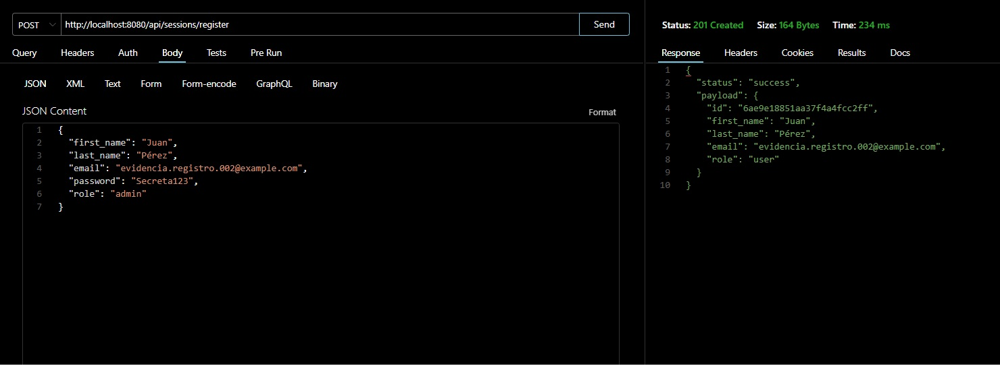
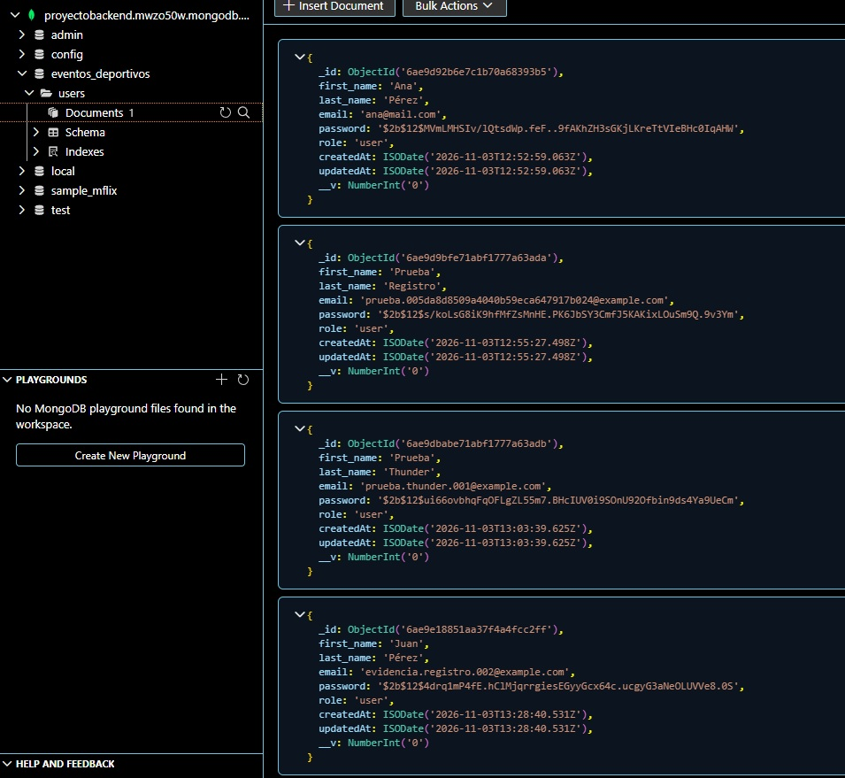
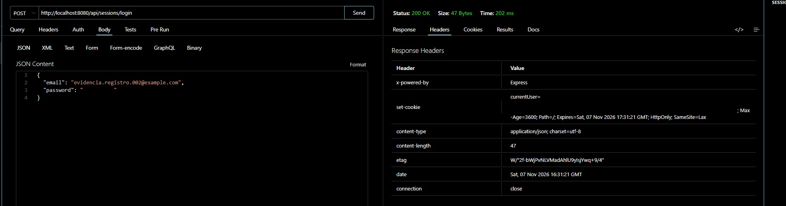
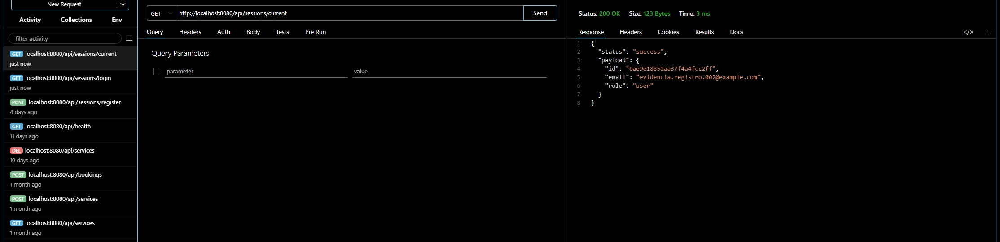
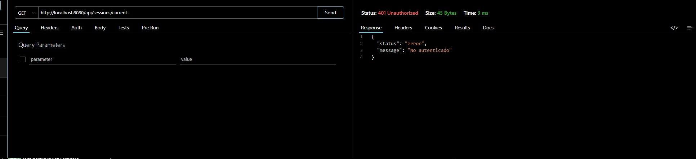

# Eventos Deportivos API

API REST para una plataforma de eventos deportivos e inscripciones. Proyecto del curso Desarrollo Avanzado de Backend II.

La plataforma está orientada a publicar torneos, encuentros y clínicas deportivas y a gestionar sus inscripciones. La preentrega 3 incorpora autenticación con JWT y cookies sobre el registro de usuarios de la preentrega anterior.

## Funcionalidades

- Registro de usuarios con validación de datos y persistencia en MongoDB.
- Email normalizado e índice único para prevenir duplicados.
- Contraseñas hasheadas con bcrypt y excluidas de las respuestas.
- Login con JWT almacenado en una cookie `HttpOnly`.
- Consulta protegida del usuario autenticado y cierre de sesión.

## Tecnologías

Node.js 22 o superior, Express, MongoDB, Mongoose, bcrypt, jsonwebtoken, cookie-parser y dotenv. El proyecto usa módulos ESM.

## Instalación

```bash
git clone https://github.com/dabouzajm-lang/eventos-deportivos-api.git
cd eventos-deportivos-api
npm ci
```

## Configuración

Creá un archivo `.env` en la raíz del proyecto a partir de `.env.example`.

En PowerShell:

```powershell
Copy-Item .env.example .env
```

En Git Bash, Linux o macOS:

```bash
cp .env.example .env
```

| Variable | Descripción | Ejemplo |
| --- | --- | --- |
| `PORT` | Puerto HTTP. Por defecto, `8080`. | `8080` |
| `NODE_ENV` | Entorno de ejecución. Por defecto, `development`. En `production` se activa `Secure` en la cookie. | `development` |
| `MONGO_URL` | Cadena de conexión a MongoDB. Es obligatoria para iniciar el servidor. | `mongodb://127.0.0.1:27017/eventos_deportivos` |
| `JWT_SECRET` | Secreto privado para firmar y verificar los JWT. | `reemplazar_por_un_secreto_propio` |
| `JWT_EXPIRES_IN` | Duración del JWT. Indicá la unidad de tiempo. Por defecto, `1h`. | `1h` |

Para generar un secreto local:

```bash
node -e "console.log(require('node:crypto').randomBytes(32).toString('hex'))"
```

Pegá el valor generado en `JWT_SECRET` dentro de `.env`. Mantené `.env.example` con valores de ejemplo y guardá las credenciales reales únicamente en `.env`.

### MongoDB

- **Atlas:** colocá en `MONGO_URL` la cadena de conexión de tu clúster. El usuario de base de datos debe tener acceso y tu IP debe estar autorizada en Atlas.
- **Local:** la URL de ejemplo requiere que MongoDB esté ejecutándose en el puerto `27017`.

La aplicación selecciona la base `eventos_deportivos` mediante `dbName` en `src/config/database.config.js`. Los usuarios se guardan en la colección `users`.

## Ejecución

```bash
npm run dev
```

Para ejecutar sin reinicio automático:

```bash
npm start
```

El servidor se conecta a MongoDB antes de empezar a recibir peticiones. Con el puerto predeterminado, la API está disponible en `http://localhost:8080`.

## Arquitectura

```text
src/
├── app.js
├── server.js
├── config/
├── routes/
├── controllers/
├── services/
├── repositories/
├── dao/
├── models/
├── middlewares/
└── utils/
```

- `app.js` configura Express, el procesamiento de JSON, `cookie-parser` y los routers.
- `server.js` conecta la base de datos e inicia el servidor.
- Las rutas delegan en los controladores. El registro y el login usan el flujo controlador → servicio → repositorio → DAO → modelo.
- `src/utils/hash.js` concentra las operaciones de bcrypt.
- `src/utils/jwt.js` firma y verifica los tokens.
- `src/middlewares/auth.middleware.js` lee `currentUser`, verifica el JWT y deja sus datos en `req.user` para la ruta protegida.

## Modelo `User`

| Campo | Características |
| --- | --- |
| `first_name` | Nombre obligatorio. |
| `last_name` | Apellido obligatorio. |
| `email` | Obligatorio, normalizado e indexado como único. |
| `password` | Obligatorio. Se guarda como hash bcrypt y se excluye de las consultas por defecto. |
| `role` | Admite `user`, `organizer` y `admin`. El registro público siempre asigna `user`. |

## Rutas

| Método | Ruta | Descripción |
| --- | --- | --- |
| `GET` | `/api/health` | Comprueba que el servidor está activo. |
| `GET` | `/api/events` | Devuelve la lista inicial de eventos. |
| `GET` | `/api/sessions` | Informa el estado del recurso de sesiones. |
| `POST` | `/api/sessions/register` | Crea un usuario en MongoDB. |
| `POST` | `/api/sessions/login` | Valida las credenciales y establece `currentUser`. |
| `GET` | `/api/sessions/current` | Devuelve el usuario autenticado a partir de la cookie. |
| `POST` | `/api/sessions/logout` | Elimina `currentUser` del cliente. |

### `GET /api/health`

Petición sin body. Respuesta `200 OK`:

```json
{ "status": "ok", "message": "Servidor activo" }
```

### `GET /api/events`

Petición sin body. Respuesta `200 OK`:

```json
{ "status": "success", "payload": [] }
```

### `GET /api/sessions`

Petición sin body. Respuesta `200 OK`:

```json
{ "status": "success", "message": "Recurso sessions preparado. Registro disponible." }
```

### `POST /api/sessions/register`

Enviar `Content-Type: application/json` con los cuatro campos obligatorios:

```json
{
  "first_name": "Ana",
  "last_name": "Pérez",
  "email": "Ana@Example.com ",
  "password": "Secreta123"
}
```

Respuesta `201 Created`:

```json
{
  "status": "success",
  "payload": {
    "id": "ID_DEL_USUARIO",
    "first_name": "Ana",
    "last_name": "Pérez",
    "email": "ana@example.com",
    "role": "user"
  }
}
```

El email se normaliza antes de buscar duplicados y guardar. La contraseña debe tener al menos ocho caracteres sin contar espacios exteriores y no superar los 72 bytes en UTF-8. El rol recibido en el body se ignora.

Los datos inválidos devuelven `400 Bad Request`. Un email duplicado devuelve `409 Conflict`:

```json
{ "status": "error", "message": "El email ya está registrado" }
```

### `POST /api/sessions/login`

Enviar `Content-Type: application/json` con las credenciales de un usuario registrado:

```json
{
  "email": "ana@example.com",
  "password": "Secreta123"
}
```

Respuesta `200 OK`:

```json
{ "status": "success", "message": "Login correcto" }
```

La respuesta establece la cookie `currentUser` con `HttpOnly`, `SameSite=Lax`, `Max-Age=3600` y `Path=/`. El atributo `Secure` se activa con `NODE_ENV=production`.

El JWT se firma con `JWT_SECRET` y vence según `JWT_EXPIRES_IN`. Los datos del usuario incluidos en el token son `id`, `email` y `role`.

Un email inexistente o una contraseña incorrecta devuelven `401 Unauthorized` con el mismo mensaje:

```json
{ "status": "error", "message": "Credenciales inválidas" }
```

### `GET /api/sessions/current`

Petición sin body, con la cookie `currentUser` obtenida en el login.

Respuesta `200 OK`:

```json
{
  "status": "success",
  "payload": {
    "id": "ID_DEL_USUARIO",
    "email": "ana@example.com",
    "role": "user"
  }
}
```

Si falta la cookie o el JWT es inválido o venció, responde `401 Unauthorized`:

```json
{ "status": "error", "message": "No autenticado" }
```

### `POST /api/sessions/logout`

Petición sin body. La respuesta indica al cliente que elimine la cookie `currentUser`.

Respuesta `200 OK`:

```json
{ "status": "success", "message": "Sesión cerrada" }
```

## Pruebas manuales

Con el servidor activo, usá Thunder Client o Postman. Mantené el mismo host en todas las peticiones y dejá que el cliente gestione la cookie.

| Paso | Petición | Resultado esperado |
| --- | --- | --- |
| 1 | `POST /api/sessions/register` con un email nuevo | `201` con email normalizado, rol `user` y sin `password`. |
| 2 | `POST /api/sessions/login` con el usuario registrado | `200` y `Set-Cookie` con `currentUser`. |
| 3 | `GET /api/sessions/current` | `200` con `id`, `email` y `role`. |
| 4 | `POST /api/sessions/logout` | `200` con `Sesión cerrada`. |
| 5 | Repetir `GET /api/sessions/current` tras el logout | `401` con `No autenticado`. |

También comprobá estos casos:

| Caso | Resultado esperado |
| --- | --- |
| Repetir el registro con el mismo email | `409` con `El email ya está registrado`. |
| Login con un email inexistente | `401` con `Credenciales inválidas`. |
| Login con una contraseña incorrecta | `401` con `Credenciales inválidas`. |
| Consultar `/current` sin cookie | `401` con `No autenticado`. |
| Consultar `/current` con un JWT manipulado o vencido | `401` con `No autenticado`. |

Desde PowerShell se puede comprobar el rechazo de una petición sin cookie y de una cookie con un valor mal formado:

```powershell
curl.exe -i http://localhost:8080/api/sessions/current
curl.exe -i -H "Cookie: currentUser=token-invalido" http://localhost:8080/api/sessions/current
```

## Evidencias de las pruebas

### Registro exitoso

`POST /api/sessions/register` responde `201 Created` con rol `user` y sin el campo `password`.



### Persistencia en MongoDB

El usuario se guarda en `eventos_deportivos.users` con la contraseña hasheada mediante bcrypt.



### Login y cookie de autenticación

`POST /api/sessions/login` responde `200 OK` y establece la cookie `currentUser` con `HttpOnly`, `SameSite=Lax` y `Max-Age=3600`.



### Consulta con sesión activa

`GET /api/sessions/current` responde `200 OK` con `id`, `email` y `role`.



### Consulta después del cierre de sesión

`GET /api/sessions/current` responde `401 Unauthorized` con el mensaje `No autenticado`.



## Autor

Juan Manuel da Bouza.